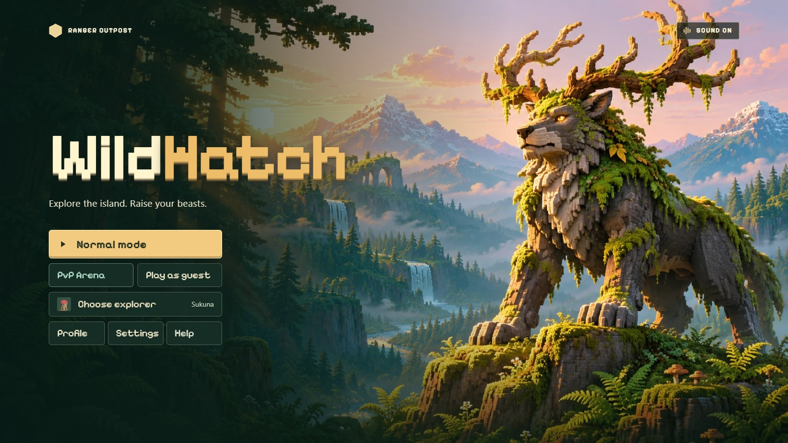
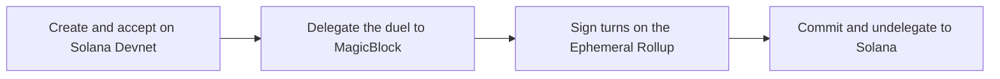

# WildHatch

Catch and raise voxel beasts across a shared archipelago. Mint eligible catches into wallet-owned collectibles, trade them through Solana escrow, and bring an owned companion into the MagicBlock arena.

[](#stack)
[](#stack)
[](#ownership-and-wild)
[](#magicblock-pvp)
[](docs/KANE.md)



[Run locally](#run-locally) · [Program on Solana Explorer](https://explorer.solana.com/address/BUfh4GsJjyH52oLkgyG3U2UT7qJwo6opLDmEUW4w7PpJ?cluster=devnet) · [Kane verification](docs/KANE.md)

## Explore the archipelago

| Mode              | What you can do                                                                                                                                           |
| ----------------- | --------------------------------------------------------------------------------------------------------------------------------------------------------- |
| **Normal mode**   | Sign in with a Solana wallet, study habitats, and catch beasts. Habitats continuously respawn with newly rolled rarity and power, and you can swap any caught beast as your **Follow me** companion or bring other rangers to the Green Dragon sanctuary. |
| **PvP Arena**     | Queue or invite a player for a 1v1 duel inside a dedicated private PvP room with rarity-scaled health and power. Open **Devnet PvP · MagicBlock** for wallet-signed matches and on-chain rewards.                                                       |
| **Play as guest** | Explore the shared world with a temporary ranger name and three practice orbs. Practice catches release the beast.                                                                                                                                      |

The island atlas and real-time animated **Habitat Radar** track nearby signals with element-coded blips and directional lock-on as players sail into a procedurally generated frontier. Supabase Realtime carries nearby movement, and the game API validates captures, progression, companion swaps, and Trading Post sales.

### Gameplay & Field UI Highlights

- **Real-time Habitat Radar:** Circular sonar scanner with sweeping phosphor beam, element-colored pulse blips, interactive tap-to-lock targeting, and compact signal distance bar (`Scan`).
- **Continuous Habitat Respawns:** Catching a beast at a habitat immediately spawns another beast of that species with a freshly rolled rarity tier, variant, and power.
- **One-Click Companion Swap:** Choose **Follow me** directly on any card in your Field Journal (or detail sheet) to swap your live 3D companion following you in the world.
- **Rarity-Scaled Combat & Private PvP Rooms:** Beast rarity (`Normal` → `Mythic`) scales health, attack, defense, speed, and PvP power, while each PvP match creates its own isolated private arena room.
- **Clean Mobile & Field Kit HUD:** Non-overlapping coarse/mobile layout keeping location telemetry, Field Kit, minimap, thumbstick, and belt shortcuts unobstructed, with **Main menu** and **Quit game** controls built into Field Kit.

## Ownership and WILD

Mint an eligible beast from the field journal and find it under **Profile → Wallet collectibles**. WildHatch verifies its traits against the issuer-signed mint transaction. In **Devnet escrow**, buyers can browse open offers, inspect those traits, and pay in Devnet SOL. After settlement, the same mint and traits appear in the buyer’s wallet collection.

| Balance         | Earn or spend it                                                                                                                                       |
| --------------- | ------------------------------------------------------------------------------------------------------------------------------------------------------ |
| **Game WILD**   | Earn it through standard arena knockouts. Spend it at the Wild Shop or Trading Post.                                                                   |
| **Devnet WILD** | Claim it after an eligible MagicBlock arena win. The Devnet shop burns SPL WILD, then the game API verifies the finalized receipt and grants supplies. |
| **Devnet SOL**  | Pay transaction fees and buy assets through on-chain escrow.                                                                                           |

The **Profile** shows all three balances. [Devnet WILD mint on Solana Explorer](https://explorer.solana.com/address/BV54wR24axhu8gw8R7WVriCufYjCLYAwXJsUat94mswj?cluster=devnet)

## MagicBlock PvP



MagicBlock Router resolves the rollup endpoint for each duel. The WildHatch program enforces turns and move order. After settlement, an eligible knockout winner can claim **12 Devnet WILD** once.

Players can show a wallet-owned beast as their arena companion. The signed entry transaction proves ownership at entry, and both players use the same combat rules.

## Stack

| Layer                | Tools and responsibilities                                                                                             |
| -------------------- | ---------------------------------------------------------------------------------------------------------------------- |
| Browser game         | **TypeScript**, **Three.js**, and **Vite** power the voxel world, character animation, and game UI.                    |
| Game service         | **Node.js** validates gameplay. **Supabase Postgres** stores progress, and **Supabase Realtime** signals live updates. |
| On-chain economy     | **Solana Devnet**, **Anchor**, and **Rust** power collectible minting, SPL WILD, and SOL escrow.                       |
| On-chain PvP         | **MagicBlock Ephemeral Rollups** run duel turns, and **MagicBlock Router** resolves their endpoints.                   |
| Browser verification | **Kane CLI** checks the wallet gate and guest expedition. Its report feeds back into Codex for fixes and reruns.       |
| Deployment           | **Vercel** serves the Vite build and routes `/api` to the game function.                                               |

## Run locally

Use **Node.js 26.x** and npm. Clone WildHatch and install its dependencies.

```sh
git clone https://github.com/sandman-sh/WildHatch.git
cd WildHatch
npm ci
```

Copy [`.env.example`](.env.example) to `.env`, fill in the Supabase settings, and apply the [multiplayer migration](supabase/migrations/20261125160000_wildhatch_multiplayer.sql) when setting up a fresh database.

```sh
npm run dev
```

Open the URL printed by Vite. Run `npm test` for gameplay and multiplayer checks. With the app running, `npm run test:kane` verifies the guest journey in a real browser. Run `npm run build` to build and scan the frontend for private files and credentials. [Kane CLI setup](docs/KANE.md)

## Deploy on Vercel

Set the project root to the WildHatch app directory. Choose **Vite** and **Node.js 26.x**, then add the following in **Project Settings → Environment Variables**.

| Variable                             | Purpose                                                                    |
| ------------------------------------ | -------------------------------------------------------------------------- |
| `WILDHATCH_DATABASE_URL`             | Server-only Supabase transaction pooler URL for the restricted game login. |
| `WILDHATCH_DATABASE_CA`              | Supabase database root certificate in PEM format.                          |
| `WILDHATCH_SUPABASE_URL`             | Supabase project URL for Realtime.                                         |
| `WILDHATCH_SUPABASE_PUBLISHABLE_KEY` | Public `sb_publishable_…` key for Realtime.                                |
| `WILDHATCH_ISSUER_KEYPAIR_JSON`      | Optional server-only issuer keypair JSON for preparing Devnet beast mints. |

For local development, `WEB_PORT` and `PORT` set the preview and API ports. `WILDHATCH_ISSUER_KEYPAIR` accepts a local issuer keypair path. Keep `.env` and signing keys out of source control.

[Supabase and Devnet setup](docs/DEVNET.md) · [Vercel environment settings](https://vercel.com/docs/environment-variables)
